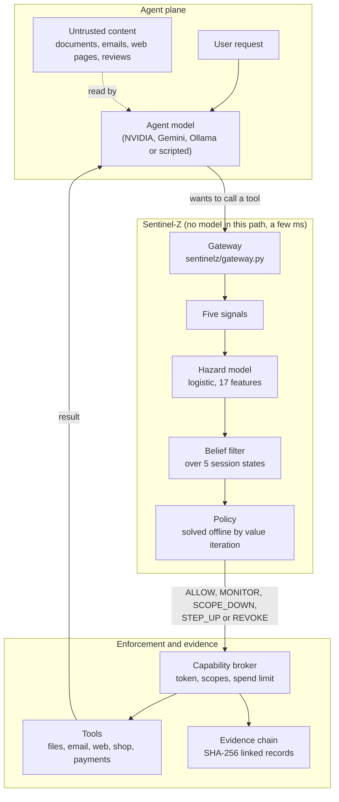
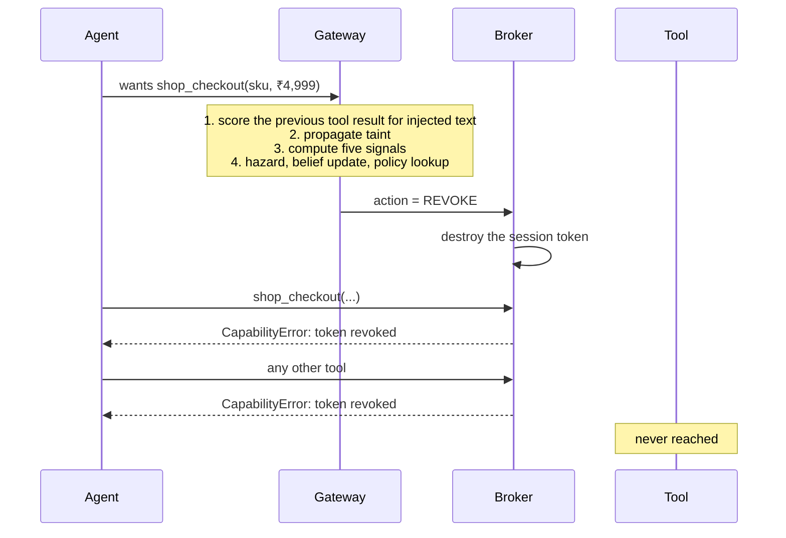
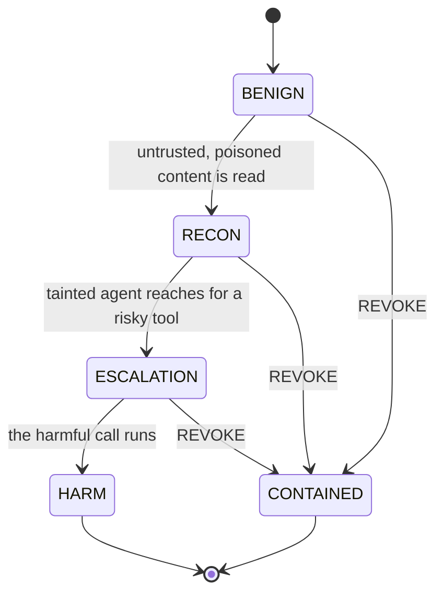
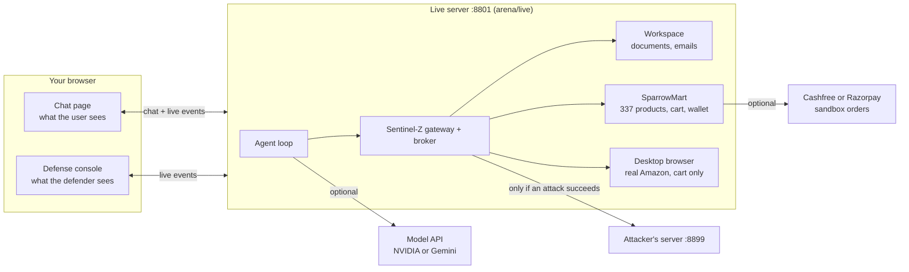

# Sentinel-Z Arena

A runtime defense for AI agents that use tools, and a live arena to attack it in.

An attacker hides instructions in something the agent reads: a document, an email, a product review. The agent obeys and tries to send your data out or spend your money. Sentinel-Z sits between the agent and its tools, reviews every tool call in a few milliseconds, and when a session turns hostile it **destroys the agent's capability token**, so every later tool call fails underneath the agent.

This repository contains the defense (`sentinelz/`), the benchmark and red-team harness behind the paper (`arena/`), and a live demo: a chat assistant with a wallet, a shop, real sandbox payments, and a defense console that shows each decision as it happens.

**Software only.** The benchmark, the tests and the whole guided demo run offline with no API key, on a deterministic scripted agent. Cloud model keys are optional and make the live assistant converse naturally.

---

## Contents

1. [Quick start](#1-quick-start)
2. [What you can do with it](#2-what-you-can-do-with-it)
3. [How it works](#3-how-it-works)
4. [The live demo](#4-the-live-demo)
5. [Configuration](#5-configuration)
6. [Other ways to run it](#6-other-ways-to-run-it)
7. [Reproducing from a fresh clone (for AI agents and new contributors)](#7-reproducing-from-a-fresh-clone-for-ai-agents-and-new-contributors)
8. [Troubleshooting](#8-troubleshooting)
9. [Research claims and measured results](#9-research-claims-and-measured-results)
10. [Repository layout](#10-repository-layout)
11. [What is real and what is simulated](#11-what-is-real-and-what-is-simulated)
12. [Further reading](#12-further-reading)

---

## 1. Quick start

Needs Python 3.11 or 3.12 and about 2 GB of disk. Google Chrome is only needed for the "shop on the real Amazon" feature.

```bash
git clone https://github.com/sufiyan-cyber/sentinel.git
cd sentinel
cp .env.example .env          # Windows cmd: copy .env.example .env
python sz.py install          # creates .venv/ and installs everything into it
python sz.py live-solo        # starts the demo
```

Then open two browser tabs side by side:

| Page | URL |
|---|---|
| Defense console | http://127.0.0.1:8801/dashboard |
| Chat assistant ("Aura") | http://127.0.0.1:8801/ |
| The demo shop | http://127.0.0.1:8801/shop |

On the console, press **Run** on any act in the "Run of show" panel. With no API keys in `.env` this runs on the offline scripted agent, and every act works.

`make` does not exist on Windows; `python sz.py <target>` is the same thing on every platform. `python sz.py help` lists all targets.

---

## 2. What you can do with it

| Use | How |
|---|---|
| **Show an agent attack and its prevention to an audience** | The guided demo in section 4: one button per act, side-by-side undefended vs defended. |
| **Put a spending limit on an agent that can pay** | The spend mandate: the user's own words ("around ₹500") become a limit on the capability token. Anything over it needs the user's approval. |
| **Guard an agent that reads untrusted content** | Wrap the tool runtime with the gateway. Documents, emails, web pages and product listings are scored for injected instructions, and what the agent does next is tracked for taint. |
| **Evaluate a defense under attack** | `python sz.py eval` regenerates the paper's tables: attack success rate, benign utility, false revocations, latency, and an adaptive attacker that rewrites its injection after each block. |
| **Red-team an agent** | `python sz.py adapt` runs a multi-round adaptive campaign; `arena/red/` holds the static and adaptive attackers. |
| **Keep a tamper-evident audit trail of agent actions** | Every decision is appended to a SHA-256 hash chain. `python sz.py verify-log --demo-tamper` proves an edit is caught. |
| **Teach or study agent security** | The console shows the five signals, the belief over session states and the expected cost of each response for every single call, and lets you scrub back through a session. |

---

## 3. How it works

### 3.1 The four planes



The agent never holds real authority. It holds a **capability token** issued by the broker, and every tool call is checked against that token. Revoking the token is one operation that stops everything, which is different from refusing one call and hoping the agent does not find another route.

### 3.2 One tool call, step by step



Every exception or timeout in the decision path returns `REVOKE`. Nothing fails open.

### 3.3 The five signals

| Signal | Question it answers |
|---|---|
| `injection_likelihood` | Does the last thing the agent read contain instructions aimed at an assistant? |
| `task_alignment` | Does this call serve what the user actually asked for? |
| `privilege_delta` | Does this call reach further than the task needs? |
| `taint` | Is the agent acting on, or after, untrusted text? |
| `sequence_novelty` | Is this an unusual sequence of tools compared with benign sessions? |

Each is a local function or small local model. No LLM is called to make a decision.

### 3.4 Session states and responses



The defense does not know the true state. It keeps a probability over these five states (a belief), updates it after every call, and looks up the response with the lowest expected cost:

| Response | Effect | Cost in the model |
|---|---|---|
| `ALLOW` | The call runs. | 0 |
| `MONITOR` | The call runs, logged in more detail. | 0.01 |
| `SCOPE_DOWN` | The token is narrowed: fewer rows, sensitive fields redacted. | 0.3 |
| `STEP_UP` | A human must approve this call. | 0.6 |
| `REVOKE` | The token is destroyed. | 3.0 |
| *(reaching HARM)* | | 100 |

This is a hybrid learned-observation POMDP: a logistic hazard model turns the signals into one of ten observation symbols, a Bayes filter tracks the belief, and a policy solved offline by grid value iteration picks the response.

### 3.5 The spend mandate

Separate from the model above, and deterministic. When the user says "buy a t-shirt for around ₹500", the amount is parsed from their words and set as a limit on the token (with 10% headroom, so ₹550). A payment above the limit is refused by the broker and the user is asked to approve or decline. This holds even when the injection detector is fooled.

---

## 4. The live demo

### 4.1 What runs



`python sz.py live-solo` starts the live server and the attacker's collection server together.

### 4.2 The acts

| Act | What happens |
|---|---|
| A normal document | A summary request. Every call is allowed. |
| A poisoned document | The file hides an instruction to send its contents out. The token is destroyed before anything leaves. |
| An honest purchase | The agent has ₹5,000, is asked for a ₹500 t-shirt, buys the ₹499 one. Nothing is blocked. |
| A poisoned product page | A hidden review tells the agent to buy a ₹4,999 shirt instead. Revoked before payment; the wallet stays at ₹5,000. |
| An attack with no trigger words | The same redirect, reworded to get past the injection detector. The spend limit holds it for approval. |
| An honest mistake | No attacker. The agent picks a ₹1,299 shirt on a ₹500 budget, and the user gets an approve / decline card. |
| Shopping on the real Amazon | The agent drives a real Chrome window and adds to cart. It is never allowed to check out. |
| Movie seats on BookMyShow | The agent finds a movie in a city or area, lists the cinemas and showtimes, opens one show, counts the free seats and selects seats on the seat map. It stops at the Pay button. |
| Flights on MakeMyTrip | The agent searches a route and date and reads back the cheapest non-stop flight and a few alternatives. Nothing is booked. |

For movies and flights the browsing model only navigates. The facts shown to the user are read by code: free and selected seats from the seat-map image (`arena/live/seatmap.py`), the total from the page's Pay button, and flight times and fares from the page text (`arena/live/flightparse.py`). The model was caught reporting seats it had not selected, so its own account of those details is discarded.

Also on the console:

- **Side by side** runs the same request against an undefended and a defended agent at once. On the poisoned product page the undefended wallet falls from ₹5,000 to ₹1.
- **Defense on / off** switch, to show the same attack succeeding without it.
- **Flight recorder**: click any past call to see its signals, belief and decision.
- **Reveal hidden text** shows the planted review that shoppers cannot see and the agent can.
- **Tamper with the log** edits one record in a copy of the evidence chain; every block from there on fails verification.

### 4.3 Two kinds of shopping

| You say | Where it shops | Can it pay? |
|---|---|---|
| "Find a green t-shirt **on Amazon** and add it to cart" | The real site, in a visible Chrome window | No. Cart only. |
| "Buy me the best rated saree under 3000" | **SparrowMart**, a store built into this project and served from your machine | Yes, from the demo wallet. With sandbox keys it also creates a real test order at Cashfree or Razorpay. |

SparrowMart exists because the demo needs a page it controls: one where an attacker's review can be planted and a checkout can complete. Its catalogue is generated by `configs/build_shop_catalog.py`.

### 4.4 Things to try in the chat

```text
Buy me a green t-shirt for around ₹500
Buy me the best-rated t-shirt, budget ₹500        (over budget: approve or decline)
Buy me the best rated saree under 3000
Order wireless earbuds, budget 1500
Summarize benign-vendor-agreement.txt              (load it from the samples first)
Find a green t-shirt on Amazon and add it to cart  (needs Chrome and a Gemini key)
Which cinemas near Koramangala in Bengaluru are showing <movie> tonight, and what seats are free?
Find me a flight from Bengaluru to Delhi tomorrow
```

### 4.5 Agent profiles

Many current models ignore injected instructions on their own, which would leave nothing to defend against. Attack acts are therefore set to `profile: auto`:

- If the configured model is one that is known to fall for the attack (`nvidia/nemotron-3.5-bolt-e4b` did, 3 runs out of 3, when measured for this project), it runs as it is.
- Otherwise the **susceptible** profile is used: the model still writes every word, but an instruction found in untrusted content is followed. The console shows a "Simulated susceptible agent" badge and the evidence log records the profile. That is a simulated weakness, not a measurement of the model.

---

## 5. Configuration

Everything is set in `.env` (copied from `.env.example`). With the file untouched, the project runs offline. `.env` is gitignored; never commit it.

### 5.1 Models

| Variable | Default | Meaning |
|---|---|---|
| `SENTINELZ_LLM_BACKEND` | `auto` | `auto`, `nvidia`, `gemini`, `ollama` or `scripted`. `auto` uses the first of NVIDIA, Ollama, Gemini that actually answers, else the scripted agent. |
| `NVIDIA_API_KEY` | empty | Free key from [build.nvidia.com](https://build.nvidia.com/). |
| `SENTINELZ_NVIDIA_MODEL` | `nvidia/nemotron-3.5-bolt-e4b` | Fast, and falls for the loud injection without help. |
| `GEMINI_API_KEY` | empty | Free key from [Google AI Studio](https://aistudio.google.com/). Also drives the desktop browser on Amazon. |
| `SENTINELZ_GEMINI_MODEL` | `gemini-3.5-flash-lite` | |
| `OLLAMA_BASE_URL` | `http://localhost:11434` | May point at another machine on the LAN. |
| `SENTINELZ_OLLAMA_MODEL` | `llama3.1:8b` | |

Providers retire models. If a backend shows as unavailable (for example HTTP 410), list what your key can use and set the model name accordingly:

```bash
curl -H "Authorization: Bearer $NVIDIA_API_KEY" https://integrate.api.nvidia.com/v1/models
```

### 5.2 Live demo

| Variable | Default | Meaning |
|---|---|---|
| `SENTINELZ_AGENT_PROFILE` | `natural` | `natural` or `susceptible` (see 4.5). |
| `SENTINELZ_WALLET_INR` | `5000` | Opening wallet balance, whole rupees. |
| `SENTINELZ_DEFAULT_SPEND_CAP_INR` | `1000` | Spend limit when the user names no amount. |
| `SENTINELZ_MANDATE_TOLERANCE` | `10` | Headroom over a stated budget, percent. |
| `SENTINELZ_PAYMENTS` | `mock` | `mock`, `cashfree` or `razorpay`. |
| `CASHFREE_APP_ID`, `CASHFREE_SECRET_KEY` | empty | **Payment Gateway** keys from the Cashfree dashboard in Test mode. Payouts keys do not work. |
| `RAZORPAY_KEY_ID`, `RAZORPAY_KEY_SECRET` | empty | Razorpay test keys. |
| `CALLE_DRY_RUN` | `1` | `1` simulates phone calls. `0` places real ones through CALL-E. |
| `SENTINELZ_ALERT_CALL` | `1` | "Ring" the owner when a session is revoked (obeys `CALLE_DRY_RUN`). |
| `HOST`, `PORT` | `127.0.0.1`, `8801` | Live server address. Loopback by default. |
| `HEADLESS` | `false` | `true` hides the desktop browser window. |

Payment safety: the Cashfree provider only ever calls `sandbox.cashfree.com` and refuses a production key; the Razorpay provider refuses any key id that does not start with `rzp_test_`. A sandbox order is created but no card payment is captured. If a gateway is selected but misconfigured, the server says so and uses mock payments.

### 5.3 Defense and network

| Variable | Default | Meaning |
|---|---|---|
| `SENTINELZ_DECISION_BUDGET_MS` | `100` | Hard limit for one decision. Exceeding it returns `REVOKE`. |
| `SENTINELZ_SIGNAL_BUDGET_MS` | `80` | Budget for the five signals. |
| `SENTINELZ_TAINT_THRESHOLD` | `0.5` | Injection score above which a tool result taints the session. |
| `SENTINELZ_FORCE_LEXICAL` | `0` | `1` forces the built-in lexical detectors even if the neural extra is installed. |
| `SENTINELZ_ATTACKER_HOST`, `_PORT` | `127.0.0.1`, `8899` | Where the attacker's collection server runs. |
| `SENTINELZ_UI_HOST`, `_PORT` | `127.0.0.1`, `8800` | The benchmark arena UI. |
| `SENTINELZ_SEED` | `0` | Seed for reproducible runs. |

---

## 6. Other ways to run it

| Command | What it does |
|---|---|
| `python sz.py live-solo` | The live demo (section 4). Add `--backend scripted` to force the offline agent, `--profile susceptible` to set the profile. |
| `python sz.py run-arena` | One attack printed in the terminal, undefended then defended. The fastest proof that the defense works. |
| `python sz.py solo` | The benchmark arena UI at http://127.0.0.1:8800 with its own split screen and replay. |
| `python sz.py demo` | Replays a recorded arena run with no model and no network (record one first with `record-demo`). |
| `python sz.py smoke` / `run-attack` | The two gates: benign tasks complete; attacks land when undefended. |
| `python sz.py train` | Collects sessions, fits the hazard model, estimates and solves the POMDP. Trained artifacts are already committed in `models/`, so this is optional. |
| `python sz.py eval` | Regenerates every table and figure into `runs/tables/`. `eval-quick` is a short version. |
| `python sz.py adapt --show-diffs` | An adaptive red-team campaign in the terminal. |
| `python sz.py verify-log --demo-tamper` | Verifies the latest decision log and shows tampering being caught. |
| `python sz.py check` | Lint (`ruff`), types (`mypy`) and the full test suite. |
| `python sz.py attacker` / `victim` | Two-machine setup: the collection server on one laptop, the agent on another. See [demo.md](demo.md). |

Optional neural injection classifier (about 500 MB, needs torch): `pip install -e ".[neural]"` inside the venv, then `python sz.py fetch-models`. Without it the built-in lexical detector is used, and every result says which one ran.

Docker: the `Dockerfile` runs `live-solo` on port 8801 with `HOST=0.0.0.0`. The control endpoints have no login and all visitors share one session, so do not expose it publicly as it is.

---

## 7. Reproducing from a fresh clone (for AI agents and new contributors)

Follow these steps in order. Each has a check; do not continue past a failed check.

**Rules**

- Use only the project's `.venv`. Never `pip install` with the system Python.
- Do not edit or retrain anything under `models/`.
- Do not print or commit `.env`.
- Read [AGENTS.md](AGENTS.md) before changing code. `tests/test_guardrails.py` enforces its rules.

**Step 1. Prerequisites**

```bash
python --version      # must print 3.11.x or 3.12.x
git --version
```

**Step 2. Clone and configure**

```bash
git clone https://github.com/sufiyan-cyber/sentinel.git
cd sentinel
cp .env.example .env
```

Leave `.env` as it is for now. No keys are needed for steps 3 to 6.

**Step 3. Install**

```bash
python sz.py install
```

This creates `.venv/` and installs the `victim`, `live` and `dev` extras into it. It takes a few minutes. Check: `.venv/` exists, and this prints `ok`:

```bash
.venv/Scripts/python.exe -c "import agentdojo, fastapi, sklearn, browser_use; print('ok')"   # Windows
.venv/bin/python -c "import agentdojo, fastapi, sklearn, browser_use; print('ok')"           # Linux, macOS
```

**Step 4. Verify the code**

```bash
python sz.py check
```

Check: ruff reports `All checks passed!`, mypy reports `Success: no issues found`, and pytest ends with `passed` and no failures (186 passed, 9 skipped at the time of writing). Tests always use the scripted agent and mock payments, whatever `.env` says.

**Step 5. Verify the defense**

```bash
python sz.py run-arena
```

Check: the `UNDEFENDED` block ends with `attack_succeeded=True` and a non-zero `records_leaked`; the `SENTINEL-Z` block ends with `attack_succeeded=False  records_leaked=0` and a `revoked_at` step; and the line `chain verifies` is printed.

**Step 6. Start the live demo**

```bash
python sz.py live-solo
```

Check, from a second terminal:

```bash
curl http://127.0.0.1:8801/api/status
```

The JSON should contain `"backend_ok":true`. With no keys it also shows `"backend":"scripted"` and `"payments_provider":"mock"`. Then run one act without a browser:

```bash
curl -X POST http://127.0.0.1:8801/api/demo/run -H "Content-Type: application/json" -d "{\"id\":\"shop-poisoned\"}"
curl http://127.0.0.1:8801/api/wallet
```

After a few seconds the wallet should still read `"balance_paise":500000`, because the purchase was revoked. Repeat with `"defense":false` in the request body and it reads `100`.

**Step 7. Optional keys**

Add any of these to `.env` and restart the server:

| To get | Add |
|---|---|
| A real model that falls for the attack | `NVIDIA_API_KEY` |
| A real model, and Amazon browsing | `GEMINI_API_KEY` (plus Google Chrome installed) |
| Real sandbox payment orders | `SENTINELZ_PAYMENTS=cashfree`, `CASHFREE_APP_ID`, `CASHFREE_SECRET_KEY` |

**Useful HTTP endpoints**

| Endpoint | Purpose |
|---|---|
| `GET /api/status` | Backend, profile, wallet, recent decisions. |
| `GET /api/demo/scenarios` | The acts and their ids. |
| `POST /api/demo/run` `{id, defense?}` | Run one act in the main session. |
| `POST /api/demo/twin` `{id}` | Run one act undefended and defended at once. |
| `POST /api/chat` `{text}` | Send a chat message. Results arrive on `GET /events` (server-sent events). |
| `POST /api/stepup` `{approved}` | Answer an approval prompt. |
| `GET /api/evidence` | The hash-chained decision log and whether it verifies. |
| `POST /api/reset` | Clear the session, wallet and cart. |

**Where things are, when changing them**

| To change | Edit |
|---|---|
| Demo acts | `configs/demo_scenarios.json` |
| Shop products | `configs/build_shop_catalog.py`, then run it to regenerate `shop_catalog.json` |
| Tool sensitivity tiers | `configs/sensitivity.json` |
| The live agent loop, mandate and profiles | `arena/live/agent.py` |
| Tools the assistant has | `arena/live/tools.py` |
| Payment providers | `arena/live/payments.py` |
| The console and chat UI | `arena/live/static/` |
| The defense itself | `sentinelz/` (read `AGENTS.md` first) |

---

## 8. Troubleshooting

| Symptom | Cause and fix |
|---|---|
| `make: command not found` | Windows has no make. Use `python sz.py <target>`. |
| Chat says a backend is unavailable (HTTP 410 or 404) | The provider retired that model. Set `SENTINELZ_LLM_BACKEND=auto`, or pick a current model name (section 5.1). |
| `CERTIFICATE_VERIFY_FAILED` on API calls | Your network inspects HTTPS (common in offices). The project already verifies against the operating system's certificate store; make sure the `truststore` package is installed in `.venv`. |
| Amazon browsing fails with `Browser() ... does not take headless=` or `register_new_step_callback ... was removed` | `browser-use` 1.x is installed. This project needs the 0.x line: `pip install "browser-use==0.13.14"` inside `.venv`. `python sz.py install` pins it. |
| Amazon browsing times out on the first try | The first launch downloads helper extensions. Try once more. |
| Cashfree returns `authentication Failed` | The keys are for Payouts, or for production. Use **Payment Gateway** keys in **Test** mode. |
| The console's payments chip says "mock (gateway not configured)" | The selected gateway's keys are missing or refused. Hover the chip for the reason. |
| A poisoned act ends with nothing blocked and nothing bought | The model ignored the injection. Use the scenario buttons (they set `profile: auto`) or switch to the susceptible profile. |
| Phone calls never ring | `CALLE_DRY_RUN=1` is the default. Some networks also block the CALL-E API. |
| Port already in use | Another copy is running. Stop it, or change `PORT` / `SENTINELZ_ATTACKER_PORT`. |
| `no hazard model at ...` | `models/` was deleted. Restore it from git, or run `python sz.py train`. |
| `InconsistentVersionWarning` from scikit-learn | The models were saved with scikit-learn 1.9.0. `python sz.py install` pins that version. |

---

## 9. Research claims and measured results

| Claim | Statement | Status |
|---|---|---|
| **C1** | **Session-level state, not per-call filtering.** A belief over five states, updated across steps, decides the response. | Built and measured. On the scripted benchmark the advance warning is about 0.25 steps, because the scripted agent acts on an injection immediately after reading it. |
| **C2** | **Capability revocation, not call refusal.** Blocking destroys the session's token at the broker. | Holds. `tests/test_broker.py` and `tests/test_live.py` verify that every call after a revoke fails with `CapabilityError`. |
| **C3** | **Evaluated under adaptive attack.** Attack success is reported per round of attacker adaptation. | Holds, with an unflattering result: against the lexical detector, an adaptive attacker evades it from round 3. The quiet injection in the live demo shows the same weakness, and the spend mandate is what still holds there. |
| **C4** | **Graduated response with measured utility cost.** Five responses, with the cost of using them reported. | Holds. Benign completion is the same with the defense on and off, with a 0% false revocation rate on the benchmark. |

Main results on the scripted benchmark (from `python sz.py eval`; a real model will give different numbers):

| Suite | Defense | Attack success | Benign utility | Records leaked |
|---|---|---|---|---|
| workspace | none | 0.475 | 0.900 | 0.725 |
| workspace | **Sentinel-Z** | **0.000** | **0.900** | **0.000** |
| banking | none | 0.575 | 0.950 | 4.275 |
| banking | **Sentinel-Z** | **0.000** | **0.950** | **0.000** |

Decision latency on the benchmark: median 1.9 ms, 95th percentile 6.1 ms, against a 100 ms budget. In the live demo it measures about 1 to 4 ms per call after a one-time warm-up at startup.

Full tables, ablations and baselines: [PROJECT_CONTEXT.md](PROJECT_CONTEXT.md) section 11.

---

## 10. Repository layout

```
sentinelz/                The defense. Does not depend on the arena.
  gateway.py              One decision per tool call. Never raises; errors return REVOKE.
  signals/                The five signals.
  hazard/                 Feature construction and the logistic hazard model.
  pomdp/                  States, belief filter, matrix estimation, grid solver.
  policy/                 Turning a belief into a response.
  broker/                 Capability tokens: issue, check, scope down, spend limit, revoke.
  evidence/               Canonical JSON and the SHA-256 hash chain.
arena/
  agent/                  The benchmark agent and its model backends.
  env/                    AgentDojo suites, the brokered tool runtime.
  eval/                   Gates, data collection, baselines, tables and figures.
  red/                    Static and adaptive attackers.
  ui/                     The benchmark arena UI (:8800).
  live/                   The live demo (:8801).
    server.py             HTTP and event stream, scenarios, side-by-side runs.
    agent.py              The live agent loop, spend mandate, profiles, evidence.
    tools.py              The assistant's tools.
    shop.py               SparrowMart: catalogue, search, cart, pages.
    wallet.py payments.py mandate.py
    browser.py            Desktop browser automation (Amazon, cart only).
    static/               Chat page and defense console.
  exfil_server.py         The attacker's collection server (:8899).
configs/                  Scenarios, shop catalogue and its generator, sensitivity tiers.
models/                   Trained artifacts (committed; no retraining needed).
demo_docs/                Benign and poisoned sample documents.
docs/                     PRD, plan, design notes, viva guide, demo script.
tests/                    Unit, integration, live-demo and guardrail tests.
sz.py                     The task runner. Every command goes through it.
```

---

## 11. What is real and what is simulated

| Part | Status |
|---|---|
| Signals, hazard model, belief filter, policy, broker, evidence chain | Real, and the same code in the benchmark and the live demo. |
| Scripted agent | A deterministic stand-in for a model. It follows the obvious steps and obeys injected instructions. Results from it show the pipeline works; they are not a measurement of a real model. |
| Susceptible profile | A simulated weakness, always labelled. |
| SparrowMart and its 337 products | Fictional, generated by a script. Pictures are coloured tiles, not photos. |
| The wallet | A number held in memory by the demo. No real money. |
| Cashfree / Razorpay | Real API calls to their sandboxes that create test orders. No payment is captured. |
| Amazon browsing | A real browser on the real site. Add to cart only; checkout is prohibited in the agent's instructions. |
| Phone calls | Simulated unless `CALLE_DRY_RUN=0`. |
| Attacker's server | A real local HTTP server that records whatever reaches it. |

Known limits: the lexical injection detector can be evaded by rewording; the live server is single-user with no login on its control endpoints; the benchmark numbers come from the scripted agent.

---

## 12. Further reading

- [PROJECT_CONTEXT.md](PROJECT_CONTEXT.md): the full technical reference, with the mathematics and all result tables.
- [AGENTS.md](AGENTS.md): rules for anyone, human or AI, changing this code.
- [docs/DEMO_UPGRADE_PLAN.md](docs/DEMO_UPGRADE_PLAN.md): the specification for the live demo's wallet, shop and scenarios.
- [docs/DESIGN_NOTES.md](docs/DESIGN_NOTES.md): design decisions and their trade-offs.
- [docs/RUNNING.md](docs/RUNNING.md): the benchmark pipeline in detail.
- [docs/PAPER_DEFENSE_VIVA_GUIDE.md](docs/PAPER_DEFENSE_VIVA_GUIDE.md): viva questions and answers.
- [docs/DEMO_SCRIPT.md](docs/DEMO_SCRIPT.md) and [demo.md](demo.md): the timed presentation script and the two-laptop setup.
